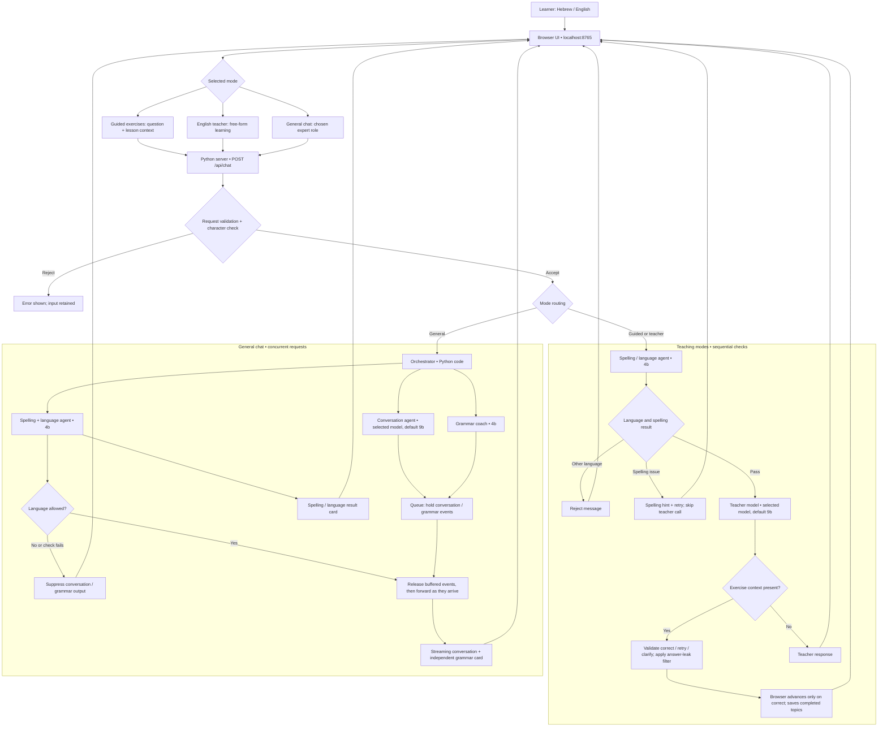
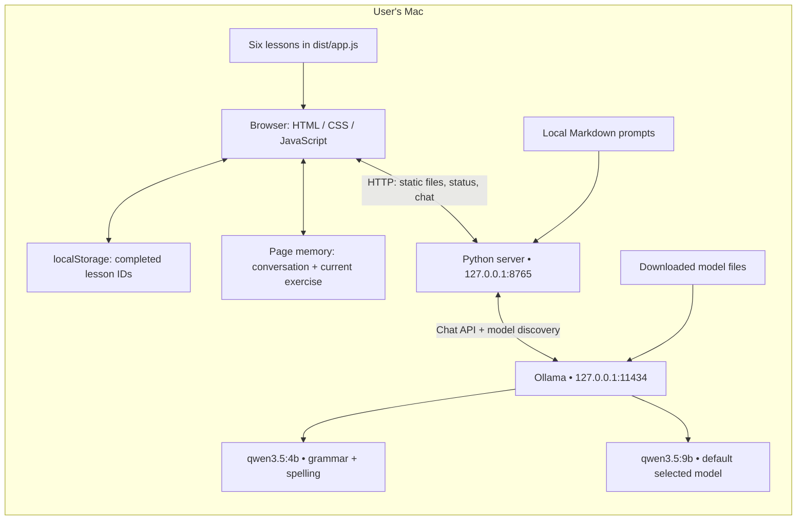

# Gesher system architecture

Current local implementation, inspected 15 October 2026. All runtime services shown run on the user's Mac. Four roles in general chat means one code orchestrator and three model calls, not four independent model installations.

## Runtime and storage

- `GET /api/status` lists models from Ollama `/api/tags`.
- Teaching modes return one JSON response. General chat uses newline-delimited JSON events; conversation text streams after language acceptance, while grammar and spelling have independent cards.
- The orchestrator starts all three workers concurrently. Ollama controls model loading and actual inference scheduling, so concurrent requests do not guarantee concurrent GPU execution or lower latency.
- General chat uses a 100-second orchestration deadline; worker HTTP reads have a 90-second timeout. A failed grammar check does not count as a successful check. A language-check failure blocks release. Disconnects stop event delivery but may not immediately stop an inference already running in Ollama.
- Models receive separate instructions and context: conversation gets the supplied history and role; grammar gets the latest five messages; spelling gets the latest message. The browser normally sends up to 28 recent conversation messages.
- Teaching modes run spelling first and can stop early with a spelling hint. They do not use the parallel three-worker flow.
- Script checks allow English ASCII letters and Hebrew letters/marks, plus numbers, punctuation and emoji. Other-language Latin text is assessed by the model, which can misclassify ambiguous words. Accented Latin letters are currently rejected. These are input checks, not an absolute output-language guarantee.
- Hint-first behavior is instructed in the prompts. The guided retry path additionally filters newly introduced English words; it is a heuristic, not a complete guarantee against answer disclosure.
- History is not persisted in a database. Switching modes/roles or reloading resets conversation. Lesson completion survives in browser localStorage.
- No deployed website, cloud inference, microphone pipeline, authentication service or learner database is part of this POC. GitHub is source hosting only and is not involved in chat requests; the requested repository upload is still pending authentication.

## Source map

| Component | Source |
|---|---|
| Interface, lessons, mode selection, history, streamed cards | `dist/index.html`, `dist/app.js`, `dist/style.css` |
| HTTP server, validation, mode routing, teaching workflow | `server.py` |
| Parallel dispatch, output gating, timeouts | `orchestrator.py` |
| Fast script validation | `language_guard.py` |
| Teacher instructions | `teacher-prompt.md` plus guided policy in `server.py` |
| Conversation instructions | `conversation-prompt.md` |
| Grammar instructions | `coach-prompt.md` |
| Spelling and semantic language instructions | `spelling-prompt.md` |
| Earlier combined prompt, no longer used by active general-chat route | `general-prompt.md` |
| Concurrency, failure isolation, blocking, script tests | `test_orchestrator.py` |
